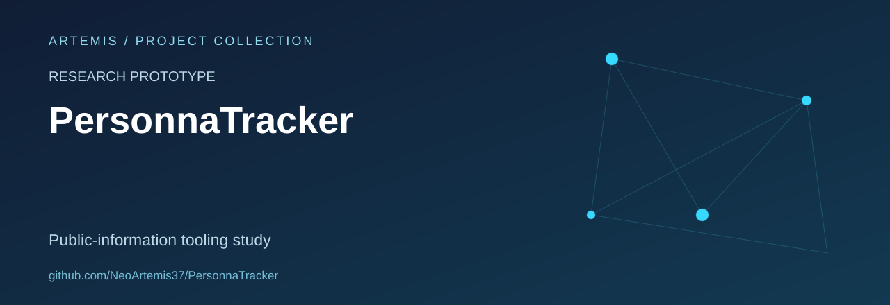

# PersonnaTracker

A Python OSINT learning project exploring identifier handling, public-source lookup interfaces and structured reporting.

**Status:** research prototype. Results and identity associations require independent verification; a matching identifier does not establish that two accounts belong to the same person.

## Repository contents

- `personna.py`: the main Python implementation.
- `requirements.txt`: declared Python dependencies.
- Existing project artwork.

The project brings several exploratory components into one script. This overview does not claim complete platform coverage, verified account ownership, reliable messaging-app detection or a production monitoring service.

## Technical direction

Useful areas for development include modular source adapters, explicit result provenance, uncertainty handling, offline test fixtures and clearer separation between observations and conclusions.

## Scope and limits

This repository is presented for source study and controlled research. Personal identifiers and derived associations can be sensitive. Demonstrations should use synthetic data or data supplied with permission, and reports should record source context and uncertainty.

No repository-wide licence file is currently included. Reuse rights and any third-party source attribution remain to be documented.
